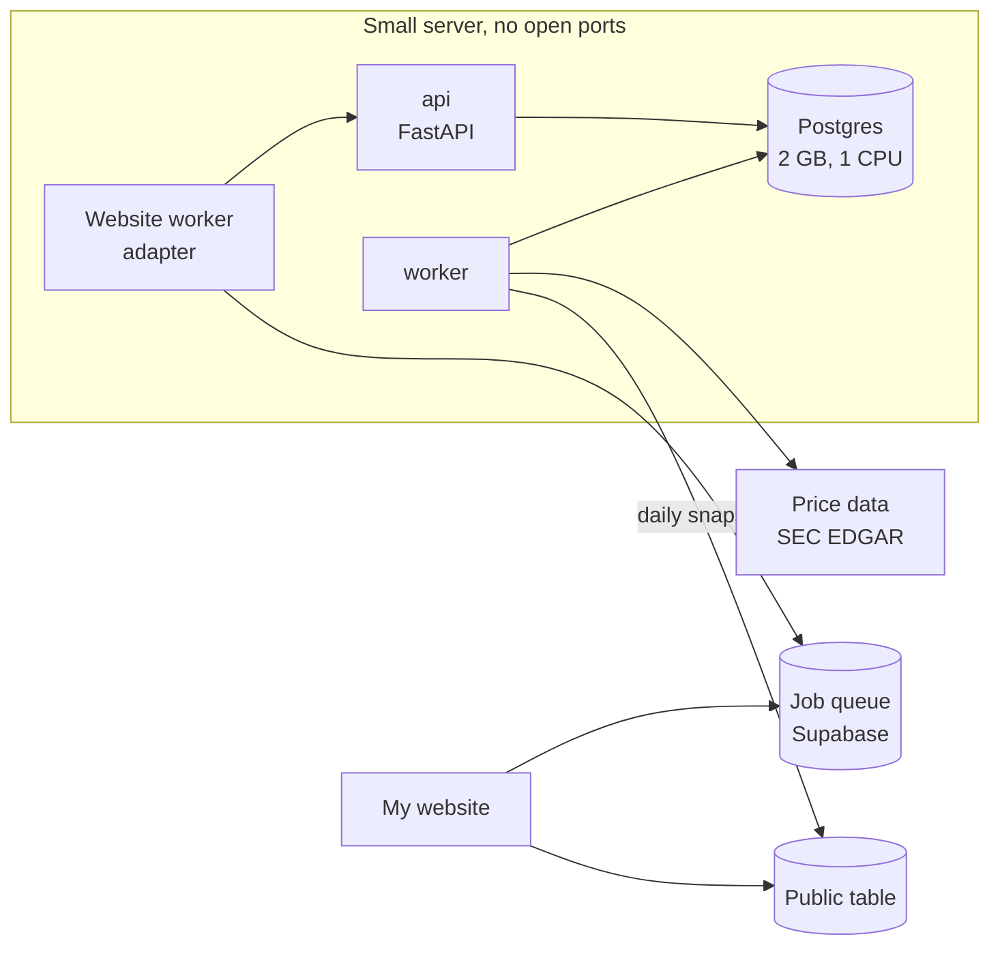

# Stock Allocation Simulator

> **Status: planning.** The design is written, the code is not. I am building the backend
> myself, one session a week. This README is a skeleton that I fill in as parts become real.
> Lines marked TODO are not true yet.

I give it an amount of money, a risk level and a time span. It picks US stocks and ETFs
with simple rules, decides how much to put in each, and shows how that portfolio would have
done against simply buying the S&P 500.

It is a simulator. No real money moves. **Not financial advice.**

<!-- TODO (M5.4): screenshot or GIF of the dashboard -->

## Why I built it

The finance is simple on purpose. The point is the engineering: a small server, a lot of
data, and outside services that fail. I create those problems on purpose, solve them, and
measure the difference.

- Postgres limited to 2 GB RAM and 1 CPU, with about 25 million rows of daily prices
- A job queue built on a Postgres table
- Data downloads that respect rate limits and are safe to run twice
- Backtests that cannot look into the future
- Results that can be reproduced exactly
- A plugin system for data sources and strategies

Every speed-up is written down with numbers before and after: [BENCHMARKS.md](BENCHMARKS.md).

## Live performance

Three model portfolios started on <!-- TODO: start date --> with $10,000 each. They are
not changed by hand and are valued after every trading day. This table is refreshed daily
by a scheduled job.

<!-- performance:start -->
| Portfolio | Value | Since start | S&P 500 (SPY) |
|---|---|---|---|
| Low risk | TODO | TODO | TODO |
| Medium risk | TODO | TODO | TODO |
| High risk | TODO | TODO | TODO |
<!-- performance:end -->

See it with charts on my website: <!-- TODO: link to the project page -->

## How it works



A request only orders the work. A worker does it in the background and the result appears
when it is ready. Once a day the worker downloads new prices, values the model portfolios
and publishes one small summary that the website reads. More in
[docs/02-architecture.md](docs/02-architecture.md).

## Run it yourself

<!-- TODO (M4): make this true -->

```bash
cp .env.example .env
docker compose up
docker compose run --rm cli sim db migrate
docker compose run --rm cli sim ingest prices --tickers SPY,MSFT,JNJ --since 2016-01-01
```

## Design decisions

| Decision | Why |
|---|---|
| Plain SQL, no ORM | The query in my code is the query in the query plan. |
| Job queue in Postgres | One less service; a job and its data change in one transaction. |
| Raw prices + a table of splits and dividends | History is never rewritten. |
| Contract first | The website was built against the API description before the backend existed. |

All ten, each with what I gave up: [docs/02-architecture.md](docs/02-architecture.md#10-key-decisions).

## Docs

| | |
|---|---|
| [Overview](docs/00-overview.md) | The idea, goals and non-goals |
| [Before I start](docs/01-before-you-start.md) | Concepts, setup, glossary, the classic traps |
| [Architecture](docs/02-architecture.md) | Parts, data flow, decisions |
| [Data model](docs/03-data-model.md) | Tables, indexes, sizes |
| [API](docs/04-api.md) and [openapi.yaml](docs/openapi.yaml) | The contract |
| [Analysis](docs/05-analysis.md) | Every number, with formula and test |
| [Plugins](docs/06-plugins.md) | How to add a data source or strategy |
| [Roadmap](docs/07-roadmap.md) | The plan, one session at a time |
| [Learning log](LEARNING.md) | Three lines after every session |

## What this is not

It does not beat the market and does not try to. The rules are a simple, fair baseline.
The universe in the first version only contains companies that exist today, which makes
past results look better than they would have been. The results say so.

Not financial advice. Past performance, simulated or real, says little about the future.
