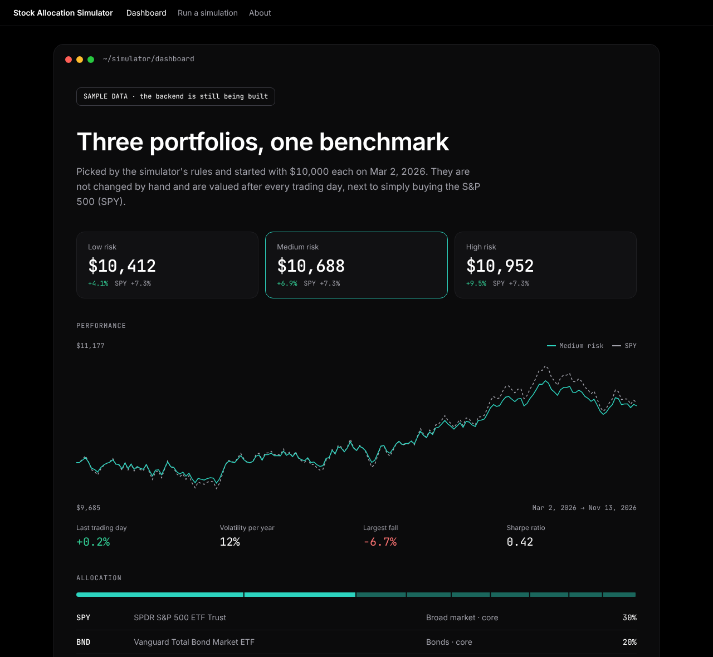
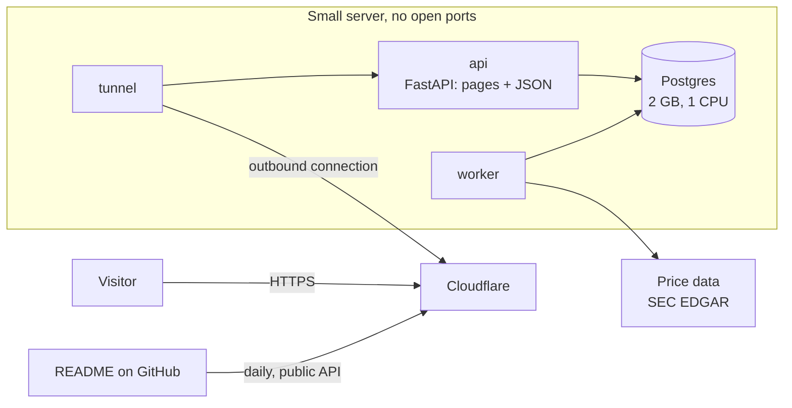

# Stock Allocation Simulator

> **Status: planning.** The design is written and the web pages exist on sample data. The
> backend does not exist yet: I am building it myself, one session a week. This README is a
> skeleton that I fill in as parts become real. Lines marked TODO are not true yet.

I give it an amount of money, a risk level and a time span. It picks US stocks and ETFs
with simple rules, decides how much to put in each, and shows how that portfolio would have
done against simply buying the S&P 500.

It is a simulator. No real money moves. **Not financial advice.**



*The dashboard on sample data. Real numbers come when the backend is built.*
<!-- TODO (M5.6): replace with a screenshot or GIF of real data, and add the link to the live site -->

## Why I built it

The finance is simple on purpose. The point is the engineering: a small server, a lot of
data, and outside services that fail. I create those problems on purpose, solve them, and
measure the difference.

- Postgres limited to 2 GB RAM and 1 CPU, with about 25 million rows of daily prices
- A job queue built on a Postgres table
- Data downloads that respect rate limits and are safe to run twice
- Backtests that cannot look into the future
- Results that can be reproduced exactly
- A public site on a server with no open ports, with rate limits and a proper admin login
- A plugin system for data sources and strategies

Every speed-up is written down with numbers before and after: [BENCHMARKS.md](BENCHMARKS.md).

## Live performance

Three model portfolios started on <!-- TODO: start date --> with $10,000 each. They are
not changed by hand and are valued after every trading day. This table is refreshed daily
by a scheduled job that reads the simulator's own public API.

<!-- performance:start -->
| Portfolio | Value | Since start | S&P 500 (SPY) |
|---|---|---|---|
| Low risk | TODO | TODO | TODO |
| Medium risk | TODO | TODO | TODO |
| High risk | TODO | TODO | TODO |
<!-- performance:end -->

See it with charts on the live site: <!-- TODO (M6.5): https://sim.<my domain> -->

## How it works



It is a standalone web app: server-rendered pages (Jinja2 templates and HTMX) and a JSON
API from the same FastAPI process. Pressing "Run simulation" only orders the work. A worker
does it in the background and the page shows the result when it is ready. Once a day the
worker downloads new prices, values the model portfolios and builds one small summary for
the dashboard. Anyone can look and run simulations, limited per IP address. Only I can
log in to the admin pages. More in
[docs/02-architecture.md](docs/02-architecture.md).

## Run it yourself

<!-- TODO (M4): make this true -->

```bash
cp .env.example .env
docker compose up
docker compose run --rm cli sim db migrate
docker compose run --rm cli sim ingest prices --tickers SPY,MSFT,JNJ --since 2016-01-01
docker compose run --rm cli sim admin set-password
```

Then open http://localhost:8000.

The pages alone, on sample data, already run today:

```bash
pip install jinja2 pyyaml
cd src && python -m sim.web.preview.serve     # http://localhost:8001
```

## Design decisions

| Decision | Why |
|---|---|
| Plain SQL, no ORM | The query in my code is the query in the query plan. |
| Job queue in Postgres | One less service; a job and its data change in one transaction. |
| Raw prices + a table of splits and dividends | History is never rewritten. |
| Contract first | The pages were built against the API description before the backend existed. |
| Server-rendered pages, no JavaScript framework | One language, one process. The backend stays the centre. |
| Public through an outbound tunnel | No open port on the server, free HTTPS and cache. |

All thirteen, each with what I gave up: [docs/02-architecture.md](docs/02-architecture.md#10-key-decisions).

## Docs

| | |
|---|---|
| [Overview](docs/00-overview.md) | The idea, goals and non-goals |
| [Before I start](docs/01-before-you-start.md) | Concepts, setup, glossary, the classic traps |
| [Architecture](docs/02-architecture.md) | Parts, data flow, decisions |
| [Data model](docs/03-data-model.md) | Tables, indexes, sizes |
| [API and pages](docs/04-api.md) and [openapi.yaml](docs/openapi.yaml) | The contract |
| [The web pages](src/sim/web/README.md) | Templates and styles, and what each page expects |
| [Analysis](docs/05-analysis.md) | Every number, with formula and test |
| [Plugins](docs/06-plugins.md) | How to add a data source or strategy |
| [Roadmap](docs/07-roadmap.md) | The plan, one session at a time |
| [Learning log](LEARNING.md) | Three lines after every session |

## Who wrote what

I write the backend: data, analysis, API, worker, security, deployment. The web pages in
`src/sim/web/` (templates, styles, chart helpers) were built by an AI model
(Fable), on my design and against my API contract, so that I can spend my time on
the backend. The docs were written together with it and reviewed by me.

## What this is not

It does not beat the market and does not try to. The rules are a simple, fair baseline.
The universe in the first version only contains companies that exist today, which makes
past results look better than they would have been. The results say so.

Not financial advice. Past performance, simulated or real, says little about the future.
