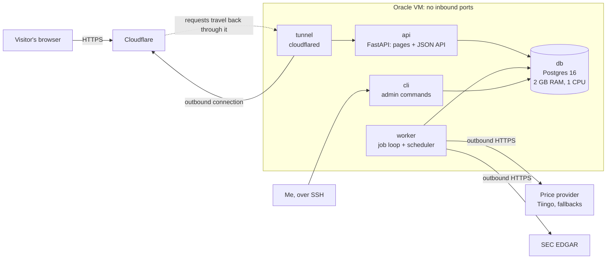
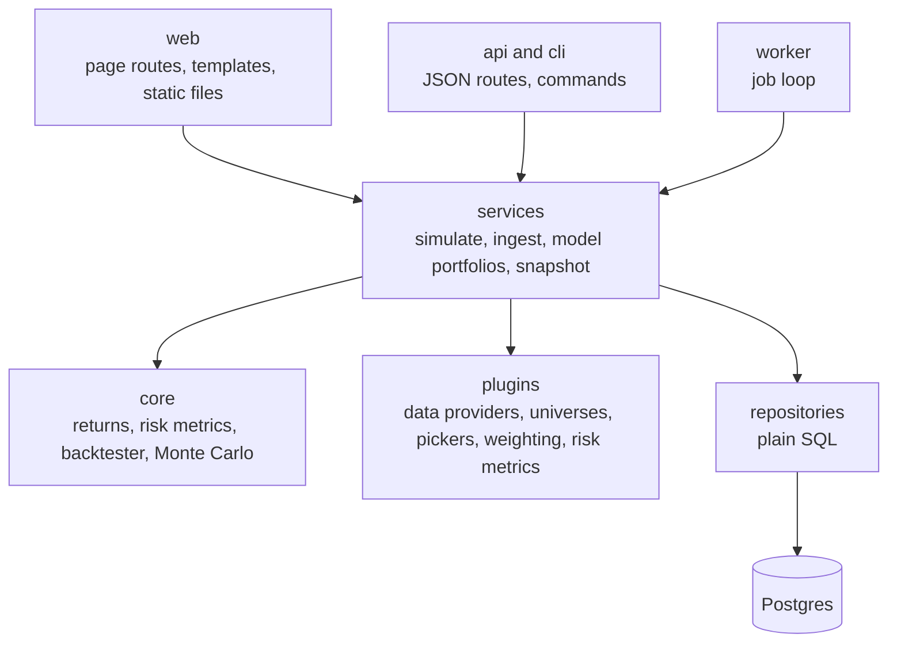
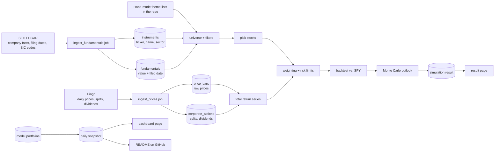
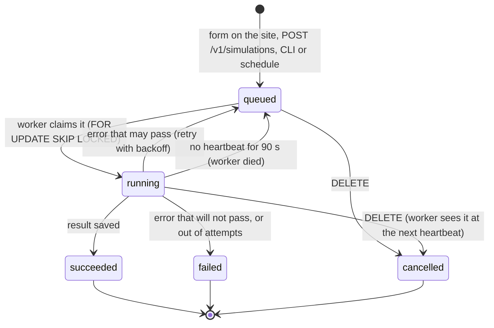
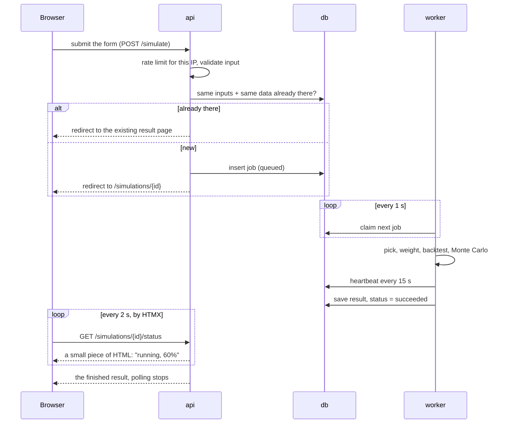
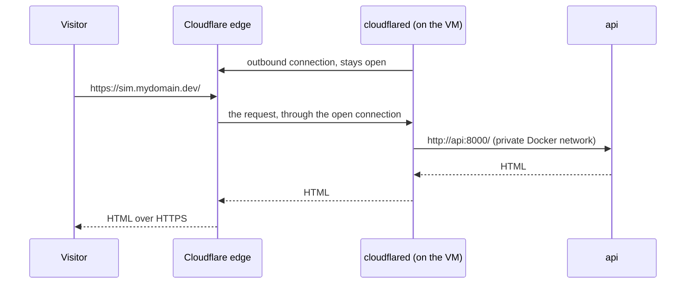

# Architecture

This file explains how the simulator is put together and why. I write the backend myself,
so every part here is something I must be able to explain in an interview.

Status: this is the plan. Nothing is built yet. When I build a part, I mark it **built**.

## 1. The short version

The simulator is a standalone web app. It has its own pages, its own API and its own
database. It does not depend on my portfolio website.

It has five parts that run as Docker containers (small isolated boxes that each run one
program):

| Part | What it does | Talks to |
|---|---|---|
| `api` | Answers HTTP requests: the web pages and the JSON API. Never does slow work itself. | `db` |
| `worker` | Does the slow work: simulations, data downloads, the daily update. | `db`, outside data sources |
| `db` | Postgres. Holds prices, company data, jobs and results. Capped at 2 GB RAM and 1 CPU on purpose. | nobody (others connect to it) |
| `cli` | A small command line tool for me: load data, rebuild model portfolios, look at jobs. | `db` |
| `tunnel` | Cloudflare's small connector program. Makes the app reachable from the internet without opening a port. Only once I have a domain. | Cloudflare (outbound), `api` |

`api`, `worker` and `cli` are the same Python package and the same Docker image. Only the
start command differs. That keeps one code base and one set of tests.



The VM opens no port to the internet. The tunnel is a connection that the VM starts
itself, going out. Until I have a domain, there is no tunnel at all, and the app runs
locally and on the VM without a public address.

## 2. What each part does

### api

- Built with FastAPI (a Python web framework that checks inputs and writes its own API
  description).
- It serves two things from the same process:
  - **web pages**, rendered on the server with Jinja2 templates (HTML files with
    placeholders) and made interactive with HTMX (a small script that lets a page swap
    parts of itself with HTML from the server, without a JavaScript framework);
  - a **JSON API** under `/v1`, described in `openapi.yaml`.
- Every slow request follows the same pattern: check the input, write a row into the `jobs`
  table, answer `202 Accepted` with a job id. The caller asks again later for the result.
- Fast requests (a finished result, the model portfolios, prices of one stock) are plain
  reads from Postgres with caching headers.
- It never calls outside data sources. If Tiingo is down, the site still works.
- Two access levels: **public** (anyone, rate-limited per IP address, no account) and
  **admin** (only me, after a login). See section 8.

### worker

One process with a simple loop:

1. Ask the database for the next job (`claim`).
2. Run it with a time limit.
3. Write the result, or the error, back.
4. Every 15 seconds, send a heartbeat (a "still alive" signal) for the job it holds.

Once a minute the same loop also checks a `schedules` table and creates jobs that are due
(daily price update, daily model portfolio update, daily snapshot). So I need no cron and no
extra scheduler container.

Job kinds in v1:

| Kind | What it does |
|---|---|
| `simulation` | One backtest + outlook for one set of inputs. |
| `ingest_prices` | Download new daily prices for the universe (the list of stocks I track). |
| `ingest_fundamentals` | Download company numbers and filing dates from SEC EDGAR. |
| `update_model_portfolios` | Value the three live model portfolios for the new day. |
| `build_snapshot` | Build the small daily summary the dashboard and the README read. |

### db

Postgres 16, with its own data volume. Limits are set in `docker-compose.yml`
(`mem_limit: 2g`, `cpus: 1.0`), and Postgres is told about them (`shared_buffers` about
512 MB, `work_mem` 16 MB, `max_connections` 20). The limit is the point of the project: with
about 25 million price rows, a careless query will be slow, and I get to fix it and measure it.

Tables are described in `03-data-model.md`.

### cli

A command called `sim`. First commands:

```
sim db migrate                 apply new SQL migration files
sim ingest prices --since ...  enqueue a price download
sim ingest fundamentals        enqueue an EDGAR download
sim models rebuild             rebuild the three model portfolios
sim snapshot build             build today's snapshot
sim jobs list | show <id>      look at the queue
sim admin set-password         set or change the admin password
```

The CLI mostly creates jobs, the same way the admin pages do. So there is one way work gets
done, and it is always visible in the `jobs` table.

### tunnel

The official `cloudflared` image with one setting: a token. It has no code of mine. Details
in section 6.

## 3. How the code is organised

Layers, from the outside in. An inner layer never imports an outer one.



- `core` is pure maths on pandas/numpy. No database, no network. That makes it easy to test
  with tiny hand-made examples.
- `plugins` are small classes behind fixed interfaces. See `06-plugins.md`.
- `repositories` is the only place that contains SQL.
- `web` holds the pages. A page route asks a service for data and hands it to a template.
  The templates get the same shapes the JSON API returns, so a page and its API endpoint
  can never show different numbers.

Planned folder layout:

```
src/sim/
  api/            JSON routes, rate limit, error format
  web/            page routes, templates/, static/ (css, fonts, htmx)
  auth/           admin login, sessions, CSRF
  worker/         loop, claim/heartbeat, scheduler
  cli/            the sim command
  services/       simulate.py, ingest.py, models.py, snapshot.py
  core/           returns.py, metrics.py, backtest.py, montecarlo.py
  plugins/        providers/, universes/, pickers/, weighting/, risk/
  repositories/   prices.py, fundamentals.py, jobs.py, ...
  sql/migrations/ 0001_init.sql, 0002_..., applied in order
tests/
docs/
```

## 4. Data flow



Three rules keep the data honest:

1. **Raw prices are never changed.** I store the price as it was on that day, plus splits and
   dividends in their own table. The "adjusted" return is calculated when reading. A split
   then only adds one row. It does not rewrite twenty years of history.
2. **Every company number carries its filing date.** A query for "earnings as known on
   1 March 2019" only sees facts filed on or before that day. This is what prevents
   look-ahead bias (using information that was not public yet).
3. **Every ingestion run gets an id.** A simulation remembers which data it saw. Same inputs
   and same data id give the same result.

## 5. The life of a job





Things I want to be able to explain:

- **Why the caller gets a job id.** A simulation can take many seconds. HTTP requests should
  be short. So the request only *orders* the work.
- **Why two workers never take the same job.** `SELECT ... FOR UPDATE SKIP LOCKED` locks the
  row one worker picked. Another worker skips locked rows and takes the next one.
- **Why a job can safely run twice.** A worker may die after doing the work but before
  saying so. Every job is written so that running it again gives the same end state
  (idempotent). Example: prices are inserted with `ON CONFLICT DO NOTHING`.
- **Retries.** Errors that may pass (a timeout, a rate limit) go back to the queue with a
  growing wait: 30 s, 2 min, 8 min. Errors that will not pass (bad input) fail at once.
- **Why the page polls instead of holding a connection open.** Polling a tiny HTML piece
  every two seconds is simple, survives a restart of the API, and costs one short indexed
  read. Server-sent events would be nicer and are a possible later step.

## 6. How people reach it

### The web interface

The pages are rendered on the server. The browser gets finished HTML. There is no React and
no build step.

| Page | Address | Who |
|---|---|---|
| Dashboard: the three model portfolios, performance vs. SPY, allocation, range of outcomes | `/` | public |
| Run your own simulation: the form | `/simulate` | public |
| One simulation: progress, then the result. The address can be shared. | `/simulations/{id}` | public |
| How it works, limits, disclaimer | `/about` | public |
| Login | `/admin/login` | public (the form), then admin |
| Data status: tickers, newest prices, gaps, last runs | `/admin` | admin |
| Jobs: the queue, start a job, look at errors | `/admin/jobs` | admin |
| Settings: turn public simulations on or off, limits | `/admin/settings` | admin |

Why Jinja2 + HTMX and not a JavaScript app:

- One language and one process. The page route calls the same service function as the JSON
  route.
- HTMX covers the two things that need interaction: the form that turns into a progress
  line and then a result, and the admin tables that refresh.
- Charts are SVG drawn on the server from the same numbers. No chart library.

The look is the same as my portfolio site ("Ledger": black ground, Inter for text,
JetBrains Mono for numbers, thin line charts, very little on screen). The colour, radius and
font values are copied once into `web/static/css/tokens.css`. Fonts and HTMX are files in
this repo, not loaded from another site, so the page makes no request to third parties.

English only for now. All text sits in the templates, so a second language later means
moving it into message files, not rewriting pages.

### Cloudflare Tunnel: public without an open port

A normal web server listens on port 443 and waits for visitors. That means a port open to
the whole internet. A tunnel turns this around: a small program on my VM (`cloudflared`)
opens a connection **out** to Cloudflare and keeps it open. When someone visits
`sim.mydomain.dev`, Cloudflare answers and passes the request back through that connection.



What I get for free: HTTPS with a certificate, protection against floods of traffic, a
cache in front of public data, and the visitor's real IP address in a header.

**Setup, step by step** (roadmap step 6.5, only once I have a domain):

1. Get a domain. The GitHub Student Developer Pack includes offers for a free first year.
2. Create a free Cloudflare account and add the domain. Cloudflare shows two nameservers.
   Enter them at the place where I registered the domain. Wait until Cloudflare says the
   domain is active.
3. In the Cloudflare dashboard, open Zero Trust, then Networks, then Tunnels. Create a
   tunnel of type "Cloudflared" and name it `stock-simulator`. Cloudflare shows a token.
4. Put the token into `.env` on the VM as `TUNNEL_TOKEN`. Never into git.
5. Add the `tunnel` service to the production compose file: the image
   `cloudflare/cloudflared`, the command `tunnel run`, the token from the environment, on
   the same Docker network as `api`. No `ports:` line anywhere.
6. Back in the dashboard, add a "public hostname" to the tunnel: subdomain `sim`, my
   domain, service `http://api:8000`. Cloudflare creates the DNS entry itself.
7. `docker compose up -d tunnel`. Open `https://sim.mydomain.dev`.
8. In the domain's SSL/TLS settings: "Always Use HTTPS" on.
9. Set `SIM_PUBLIC_URL=https://sim.mydomain.dev` and `SIM_TRUST_PROXY=cloudflare` in `.env`
   (so the app reads the visitor's IP from Cloudflare's header and marks cookies as
   secure), then restart `api`.
10. Optional second lock for the admin pages: a Cloudflare Access rule for `/admin*` that
    only lets my email address through (free for up to 50 users). See section 8.

Things to know:

- Cloudflare sees all traffic unencrypted at its edge. For a public demo with no user
  accounts that is fine. I would think again before sending private data through it.
- The free plan's terms are meant for websites, not for serving large files. I serve HTML
  and small JSON, so that fits.
- Without a domain there is a "quick tunnel" (`cloudflared tunnel --url ...`) that gives a
  random `trycloudflare.com` address. It changes on every start and has no guarantees. Good
  for showing a friend, not for the README.

**Before the domain exists:** on my Mac the app is at `http://localhost:8000`. On the VM it
has no public address; I reach it through an SSH tunnel
(`ssh -L 8000:localhost:8000 vm`). Nothing in the app changes between these three
situations except two environment variables.

### GitHub

The README must work alone for recruiters. A scheduled GitHub Action calls the simulator's
own public API (`GET /v1/snapshot/latest`) and refreshes a small performance table in the
README each day. It needs no secret, because that endpoint is public. Until the public
address exists, the table is updated by hand.

### My portfolio website

Not connected. Later, optionally: a link and a small summary card on the portfolio that
reads the same public endpoint. Nothing in this repo depends on it.

## 7. RAM and CPU budget on the shared VM

The Oracle Always Free VM has 2 OCPU and 12 GB RAM in total, shared with the portfolio
worker (which keeps running there for the website's own jobs).

| Container | RAM limit | CPU limit | Why this size |
|---|---|---|---|
| OS + Docker | about 1 GB | - | measured later, not a limit |
| portfolio `worker` | 2 GB | 1.0 | already set in the portfolio repo |
| sim `db` | 2 GB | 1.0 | the constraint the project is about |
| sim `api` | 512 MB | 0.5 | pages, reads and inserts |
| sim `worker` | 1.5 GB | 1.0 | pandas work on a few hundred price series |
| sim `tunnel` | 128 MB | 0.25 | only passes requests along |
| free | about 5 GB | - | Linux uses it as file cache, and room for a second worker |

Honest notes:

- The CPU limits add up to more than the VM has. A limit is a ceiling, not a reservation.
  If everything is busy at once, things slow down. That is fine and is itself something to
  measure.
- Load tests must not run on the VM, or the test tool steals CPU from what it tests. I run
  k6 or Locust on my Mac through an SSH tunnel, also after the public address exists:
  hammering my own site through Cloudflare would test Cloudflare, and is not what their
  free plan is for.
- Disk: about 25 million price rows need roughly 2 to 3 GB with indexes. The free tier has
  200 GB of block storage in total, so disk is not the problem. RAM is.

**What could cost money:** nothing in this plan. Things to watch: the domain after its free
first year (about €10 to €15 a year for `.dev`); Oracle can reclaim idle Always Free
machines and capacity is not guaranteed (fallback: any small VPS runs the same compose
file, about €4 a month, so ask myself first); Tiingo's paid plans start at $30 a month, I
stay on the free one; Cloudflare's tunnel, DNS and Access are free at this size.

## 8. Security

The app is meant to be public. So I assume strangers and bots will send it anything.

### Two access levels

| | Public | Admin |
|---|---|---|
| Who | anyone | only me |
| Proof | none | login with a password, then a session cookie |
| May | see the dashboard, run simulations, read results, read public data | see data status and jobs, start jobs, change settings |
| Limited by | rate limits per IP address | login attempts are limited too |

There are no user accounts and no API tokens. That removes a whole class of problems:
nothing to register, nothing to leak, no personal data stored.

### Admin login: the options

| Option | How it works | Good | Bad |
|---|---|---|---|
| HTTP Basic Auth | The browser asks for a password and sends it with every request. | Five lines of code. | Password travels on every request, no logout, no protection against guessing unless I add it. |
| Own login page + session cookie | I type a password once. The server checks it against a stored hash and gives the browser a random session id in a cookie. | Works the same locally, on the VM and behind the tunnel. Logout works. I learn how logins really work. | I must get the details right (list below). |
| Login with GitHub (OAuth) | GitHub confirms who I am. | No password of my own. | Needs a registered app, callback addresses and a public URL. More moving parts than one admin needs. |
| Cloudflare Access | Cloudflare shows a login before the request even reaches my VM. | No code. Very strong. | Only exists behind the tunnel. Locally and on the VM without a domain there would be no login at all. |

**My choice: my own login page with a session cookie.** It is the simplest option that is
secure in all three places the app runs. Once the tunnel exists, I add Cloudflare Access in
front of `/admin*` as a second lock. Then an attacker would have to get past Cloudflare and
past my login.

The details that make it secure:

- **One admin, no users table.** The password is set with `sim admin set-password` and
  stored only as an Argon2id hash (a deliberately slow, salted one-way function, so a
  stolen hash cannot be turned back into the password by guessing fast).
- **Sessions live in the database** (`admin_sessions`): a random 256-bit id, stored as a
  hash, with an expiry of 12 hours. Logout deletes the row. Changing the password deletes
  all rows.
- **The cookie** is `HttpOnly` (JavaScript cannot read it), `Secure` (HTTPS only, when
  behind the tunnel) and `SameSite=Strict` (never sent along with a request that started on
  another site).
- **CSRF protection** (stopping another website from making my browser send an admin
  request): every admin form carries a hidden random token tied to my session, HTMX sends
  it as a header, and the server also checks the `Origin` header.
- **Login attempts are limited:** 5 per 15 minutes per IP address, with the same slow answer
  for a wrong and a right user, and a log line for every failure.
- **Every admin route checks the session in one shared dependency**, not in each function.
  A test walks over all routes under `/admin` and `/v1/admin` and fails if one answers
  without a session.

### Public exposure

| Risk | Defence |
|---|---|
| Someone floods the simulation form and keeps the worker busy | Per IP address: 5 simulations per 10 minutes and 30 a day. Overall: at most 50 waiting jobs, then 503. Identical requests are answered from stored results without new work. An admin switch turns public simulations off. |
| Someone hammers read endpoints | 120 requests a minute per IP. Public data carries caching headers, so Cloudflare and browsers answer most repeats themselves. |
| Faking the IP address to dodge limits | The real address is read from Cloudflare's `CF-Connecting-IP` header **only** when `SIM_TRUST_PROXY=cloudflare` is set. The API is reachable only from the tunnel container, so nobody else can send that header. |
| Storing IP addresses (personal data under GDPR) | Limits use a keyed hash (HMAC) of the address, kept in memory or for at most a day. Logs contain the hash, never the address. |
| Bad input | Every field has a type and bounds in the contract (capital, years, list lengths, patterns). pydantic rejects the rest with 422. A request cannot ask for a million Monte Carlo paths. |
| SQL injection | Queries use parameters, never string building. Sorting and filtering options are picked from fixed lists. |
| Script injection (XSS) | Jinja2 escapes every value by default. No user text is ever shown as HTML. The only user-chosen values on a page are numbers and ids from fixed lists. |
| Clickjacking, sniffing, mixed content | Security headers on every response, see below. |
| Guessing simulation addresses | Ids are random UUIDs. Results contain nothing private anyway. |
| Secrets | In a git-ignored `.env` on the machine. `.env.example` lists names only. |
| Database access | The `api` role cannot change prices. Neither role is a superuser. The database is not on the tunnel's network. |
| Containers | Run as a non-root user, read-only file system where possible, no published ports in production. |

**Security headers** on every response:

| Header | Value | What it does |
|---|---|---|
| `Content-Security-Policy` | `default-src 'self'; style-src 'self'; script-src 'self'; img-src 'self' data:; font-src 'self'; frame-ancestors 'none'; base-uri 'self'; form-action 'self'` | The browser loads scripts, styles and fonts only from my own address. No inline scripts. |
| `Strict-Transport-Security` | `max-age=63072000; includeSubDomains` | Always use HTTPS (sent only behind the tunnel). |
| `X-Content-Type-Options` | `nosniff` | Do not guess file types. |
| `Referrer-Policy` | `strict-origin-when-cross-origin` | Do not leak full addresses to other sites. |
| `Permissions-Policy` | `camera=(), microphone=(), geolocation=()` | The site needs none of these. |
| `X-Frame-Options` | `DENY` | The site cannot be shown inside another page. |

Because the policy forbids inline scripts and inline styles, the templates contain none.
HTMX is configured through attributes and one small script file.

**Caching headers:**

| What | `Cache-Control` |
|---|---|
| Dashboard, snapshot, model portfolios | `public, max-age=300` |
| A finished simulation | `public, max-age=86400, immutable` |
| A running simulation, the form, all progress pieces | `no-store` |
| Everything under `/admin` | `no-store` |
| Static files (with a version in the file name) | `public, max-age=31536000, immutable` |

**A legal note for myself.** A public website run from Germany normally needs an Impressum
and a short privacy notice (what is logged, that Cloudflare sits in front). That is my
decision to make before the public address goes live; it is on the checklist in roadmap
step 6.5.

## 9. Observability (seeing what happens inside)

- **Logs** as JSON lines, one event per line, each with a request id or job id.
- **Metrics** at `GET /metrics` in Prometheus format (a common text format for numbers over
  time): request count and duration per route, job duration per kind, queue length, cache
  hits and misses, provider errors, rate-limit rejections. Admin only.
- **Slow queries** through the Postgres extension `pg_stat_statements` and
  `log_min_duration_statement = 200ms`.
- **p50 / p95.** The median and the slowest-5% response time. Every entry in `BENCHMARKS.md`
  has these two numbers before and after a change.
- In v1 I read metrics on the admin pages and with a small script. Prometheus + Grafana
  containers are an optional later step, because they cost RAM on the shared VM.

## 10. Key decisions

Each one in short: the decision, why, and what I gave up.

### D1. Plain SQL with psycopg 3, no ORM

- **Decision:** I write SQL by hand in the `repositories` folder and run it with psycopg 3
  (the Postgres driver for Python). Schema changes are numbered `.sql` files applied by
  `sim db migrate`.
- **Why:** The project is about learning Postgres. With plain SQL, the query in my code is
  exactly the query I see in `EXPLAIN ANALYZE` and in the slow-query log. An ORM (a library
  that writes SQL for me from Python classes) would hide what I want to learn.
- **Gave up:** convenience. More typing, and I map rows to Python objects myself. No
  automatic migration generation.

### D2. The job queue is a Postgres table

- **Decision:** A `jobs` table, claimed with `FOR UPDATE SKIP LOCKED`.
- **Why:** One less service to run and to give RAM to. A job and its data are written in the
  same transaction, so they can never disagree.
- **Gave up:** speed at very high job rates, and built-in features like delayed jobs. Redis
  becomes a bottleneck-loop step only if a measurement shows the queue is the bottleneck.
  I expect it will not be.

### D3. One Docker image, three start commands

- **Decision:** `api`, `worker` and `cli` share one image.
- **Why:** One build, one dependency list, no version drift between parts.
- **Gave up:** a slimmer API image (it carries pandas although it hardly needs it).

### D4. Raw prices plus a corporate actions table

- **Decision:** Store unadjusted prices. Store splits and dividends separately. Compute
  total returns when reading.
- **Why:** Adjusted prices change backwards in time whenever a new dividend is paid. That
  would rewrite old rows and break reproducibility. Raw data is append-only.
- **Gave up:** simplicity. I must apply splits and dividends correctly myself. That is one
  of the data correctness lessons I want.

### D5. Tiingo first, behind a provider interface

- **Decision:** Prices come from Tiingo's free end-of-day API, written as a plugin. Stooq's
  bulk download is the plan for the one-time large history load. yfinance is the fallback.
- **Why:** Tiingo is an official API with a key and written limits, and it returns raw
  prices, splits and dividends per day. yfinance is unofficial and breaks without notice.
- **Gave up:** speed. The free plan allows about 50 requests an hour and 1,000 a day. With
  one request per ticker, a daily update of 500 tickers takes about ten hours of slow,
  steady fetching. That limit is a feature for this project: it forces a rate limiter,
  resumable ingestion and a queue of work.
- **To check myself before M1:** Tiingo's free plan is for personal, internal use, and the
  site is now public. The dashboard and results show values of whole portfolios. The
  endpoint `GET /v1/instruments/{ticker}/prices` returns raw prices of single stocks, which
  is redistribution. **That endpoint stays admin-only until I have read the terms and am
  sure.** The date goes into `01-before-you-start.md`.

### D6. Start with about 500 tickers, grow to 5,000 later

- **Decision:** v1 uses roughly today's large US companies plus about 30 ETFs. The full
  5,000 tickers (about 25 million rows) are loaded in their own milestone, before the load
  tests.
- **Why:** With the free limits, 5,000 tickers cannot be kept fresh daily. And I should not
  wait weeks for data before writing the first metric.
- **Gave up:** the "big data" problem in the first weeks, and I accept survivorship bias in
  v1 (today's companies only). The result pages must say so.

### D7. The API does not cache in a separate service

- **Decision:** v1 caching has four plain layers: (1) a simulation with the same inputs and
  the same data id is not computed again, the stored result is returned; (2) HTTP caching
  headers (`ETag`, `Cache-Control`) on read endpoints; (3) Cloudflare's cache in front of
  public data, once the tunnel exists; (4) Postgres' own memory cache.
- **Why:** These are free and teach the core idea: a cache needs a key and a rule for when it
  is stale. Here the rule is simple: new data id, new key.
- **Gave up:** an in-memory cache for hot price series. That is a planned bottleneck-loop
  step, added when a load test shows it helps.

### D8. Server-rendered pages with Jinja2 and HTMX

- **Decision:** The web interface is HTML rendered by FastAPI. No React, no build step.
- **Why:** One language, one process, one deployment. The pages need little interaction.
  The backend stays the centre of the project.
- **Gave up:** rich client-side interaction (hover values on charts, instant filtering).
  If I ever want that, the JSON API is already there for a separate frontend.

### D9. Contract first

- **Decision:** `docs/openapi.yaml` is written before the code. A test in CI compares it with
  the schema FastAPI generates from my code and fails when they differ.
- **Why:** The pages were designed against the contract's examples before the backend
  existed. The contract is the promise between pages, API and README refresh.
- **Gave up:** freedom to change the API on a whim. A change now needs the contract, the
  code and maybe the templates' sample data to move together.

### D10. Simple, explainable finance

- **Decision:** Rule-based picking, three weighting methods, bootstrap Monte Carlo. No machine
  learning, no factor models.
- **Why:** The point is the engineering. And I must be able to explain every number.
- **Gave up:** any claim that the picks are good. They are a fair, simple baseline.

### D11. Public through Cloudflare Tunnel

- **Decision:** The only way in from the internet is an outbound tunnel to Cloudflare.
- **Why:** No open port on the VM, free HTTPS, a cache and flood protection in front, €0.
- **Gave up:** independence. Cloudflare can read the traffic and can be down. The app also
  runs without it, so I can move to a normal reverse proxy later.

### D12. No accounts; one admin with a password login

- **Decision:** Visitors are anonymous and limited per IP address. I am the only admin, with
  my own login page and server-side sessions, plus Cloudflare Access later.
- **Why:** No personal data to protect, nothing to register. The login works the same in all
  three places the app runs.
- **Gave up:** per-user history ("my past simulations"). A shared link to a result replaces it.

### D13. Standalone, not part of my portfolio website

- **Decision:** The simulator has its own pages and its own address. The earlier plan
  (reached only through the portfolio's job queue, with a snapshot pushed to the portfolio's
  database) is dropped.
- **Why:** One system to understand, deploy and explain. No second repo that must change
  whenever the API does.
- **Gave up:** the portfolio's ready-made quota and demo system. I build rate limiting
  myself, which is a better story anyway.
