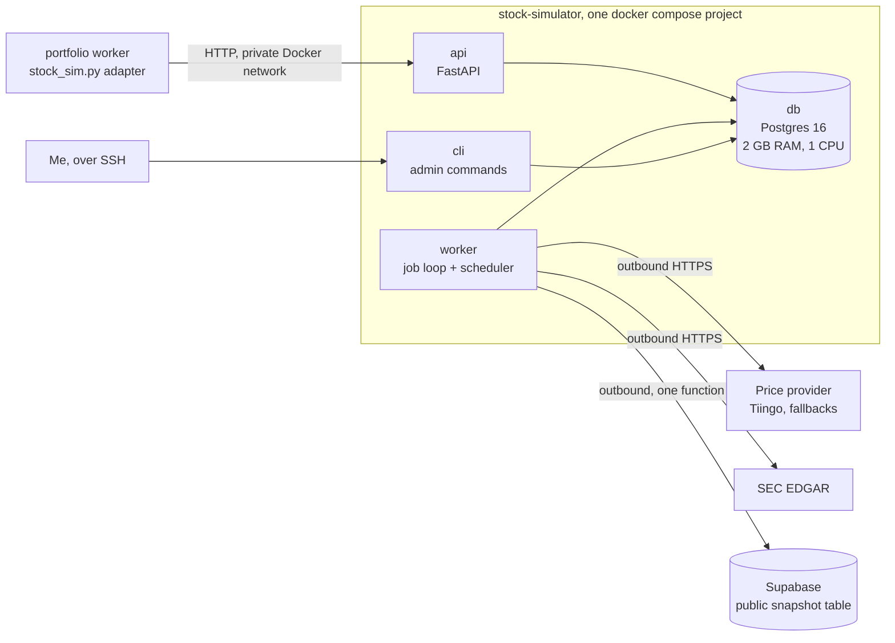
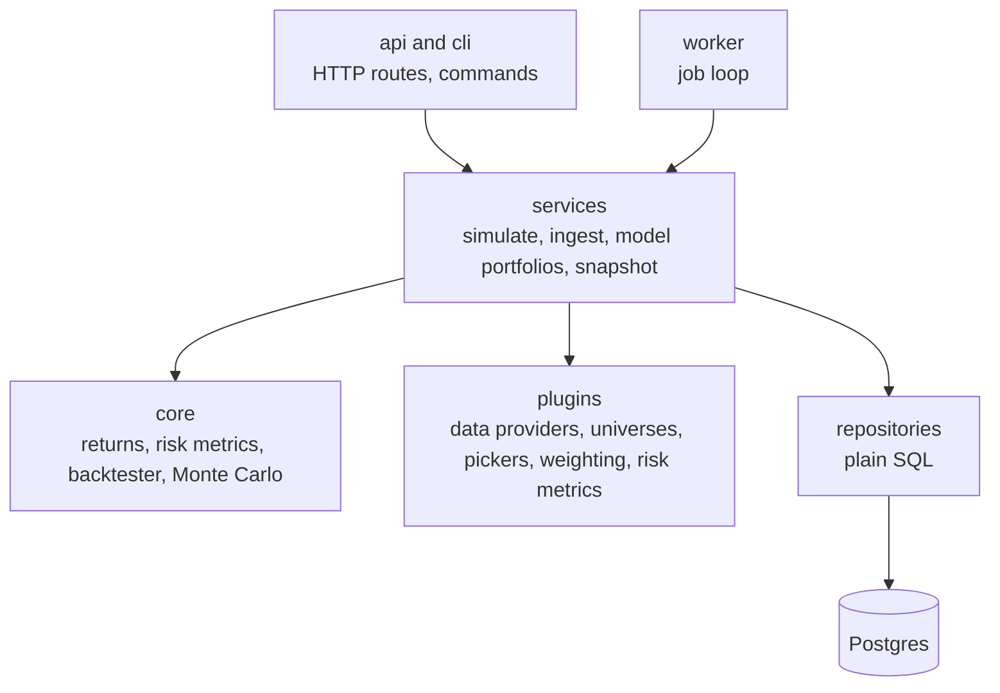
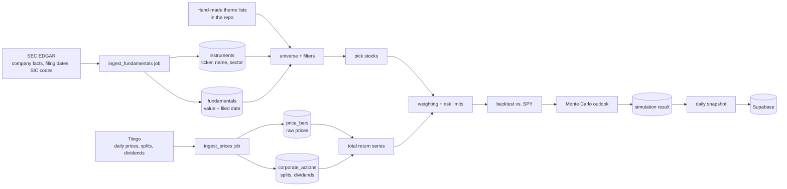
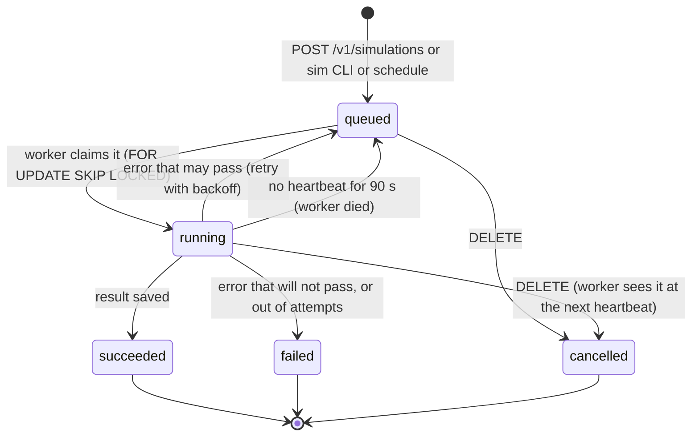
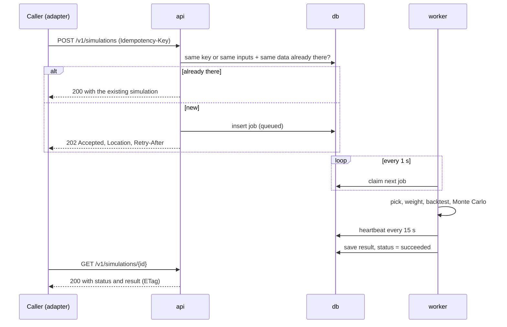
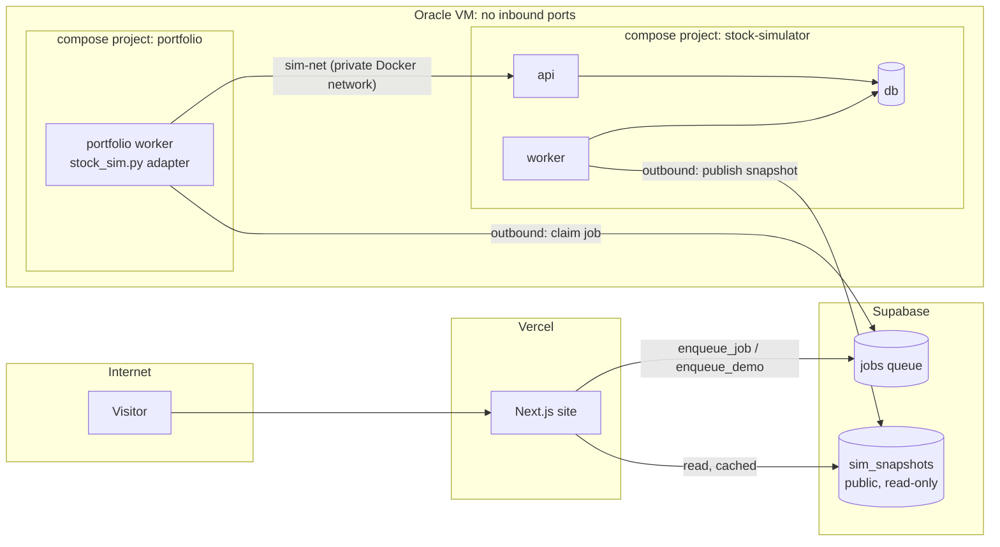

# Architecture

This file explains how the simulator is put together and why. I write the code myself, so
every part here is something I must be able to explain in an interview.

Status: this is the plan. Nothing is built yet. When I build a part, I mark it **built**.

## 1. The short version

The simulator is a backend with no web pages of its own. It has four parts that run as
Docker containers (small isolated boxes that each run one program):

| Part | What it does | Talks to |
|---|---|---|
| `api` | Answers HTTP requests. Never does slow work itself. | `db` |
| `worker` | Does the slow work: simulations, data downloads, the daily update. | `db`, outside data sources, Supabase |
| `db` | Postgres. Holds prices, company data, jobs and results. Capped at 2 GB RAM and 1 CPU on purpose. | nobody (others connect to it) |
| `cli` | A small command line tool for me: load data, rebuild model portfolios, look at jobs. | `db` |

`api`, `worker` and `cli` are the same Python package and the same Docker image. Only the
start command differs. That keeps one code base and one set of tests.



Nothing listens on the internet. The API is only reachable from inside a private Docker
network on the same machine.

## 2. What each part does

### api

- Built with FastAPI (a Python web framework that checks inputs and writes its own API
  description).
- Every slow request follows the same pattern: check the input, write a row into the `jobs`
  table, answer `202 Accepted` with a job id. The caller asks again later for the result.
- Fast requests (a finished result, the model portfolios, prices of one stock) are plain
  reads from Postgres with caching headers.
- It never calls outside data sources. If Tiingo is down, the API still answers.
- Two access levels, each with its own secret token: `service` (the portfolio adapter) and
  `admin` (me). See section 8.

### worker

One process with a simple loop:

1. Ask the database for the next job (`claim`).
2. Run it with a time limit.
3. Write the result, or the error, back.
4. Every 15 seconds, send a heartbeat (a "still alive" signal) for the job it holds.

Once a minute the same loop also checks a `schedules` table and creates jobs that are due
(daily price update, daily model portfolio update, daily snapshot). So I need no cron and no
extra scheduler container.

Job kinds in v1:

| Kind | What it does |
|---|---|
| `simulation` | One backtest + outlook for one set of inputs. |
| `ingest_prices` | Download new daily prices for the universe (the list of stocks I track). |
| `ingest_fundamentals` | Download company numbers and filing dates from SEC EDGAR. |
| `update_model_portfolios` | Value the three live model portfolios for the new day. |
| `export_snapshot` | Build the small daily snapshot and send it to Supabase. |
| `admin_command` | Later: commands sent from admin pages on the website. Designed, not built. |

### db

Postgres 16, with its own data volume. Limits are set in `docker-compose.yml`
(`mem_limit: 2g`, `cpus: 1.0`), and Postgres is told about them (`shared_buffers` about
512 MB, `work_mem` 16 MB, `max_connections` 20). The limit is the point of the project: with
about 25 million price rows, a careless query will be slow, and I get to fix it and measure it.

Tables are described in `03-data-model.md`.

### cli

A command called `sim`. First commands:

```
sim db migrate                 apply new SQL migration files
sim ingest prices --since ...  enqueue a price download
sim ingest fundamentals        enqueue an EDGAR download
sim models rebuild             rebuild the three model portfolios
sim snapshot export            build and publish today's snapshot
sim jobs list | show <id>      look at the queue
```

The CLI mostly creates jobs, the same way the API does. So there is one way work gets done,
and it is always visible in the `jobs` table.

## 3. How the code is organised

Layers, from the outside in. An inner layer never imports an outer one.



- `core` is pure maths on pandas/numpy. No database, no network. That makes it easy to test
  with tiny hand-made examples.
- `plugins` are small classes behind fixed interfaces. See `06-plugins.md`.
- `repositories` is the only place that contains SQL.

Planned folder layout:

```
src/sim/
  api/            routes, auth, rate limit, error format
  worker/         loop, claim/heartbeat, scheduler
  cli/            the sim command
  services/       simulate.py, ingest.py, models.py, snapshot.py
  core/           returns.py, metrics.py, backtest.py, montecarlo.py
  plugins/        providers/, universes/, pickers/, weighting/, risk/
  repositories/   prices.py, fundamentals.py, jobs.py, ...
  sql/migrations/ 0001_init.sql, 0002_..., applied in order
tests/
docs/
```

## 4. Data flow



Three rules keep the data honest:

1. **Raw prices are never changed.** I store the price as it was on that day, plus splits and
   dividends in their own table. The "adjusted" return is calculated when reading. A split
   then only adds one row. It does not rewrite twenty years of history.
2. **Every company number carries its filing date.** A query for "earnings as known on
   1 March 2019" only sees facts filed on or before that day. This is what prevents
   look-ahead bias (using information that was not public yet).
3. **Every ingestion run gets an id.** A simulation remembers which data it saw. Same inputs
   and same data id give the same result.

## 5. The life of a job





Things I want to be able to explain:

- **Why the caller gets a job id.** A simulation can take many seconds. HTTP requests should
  be short. So the request only *orders* the work.
- **Why two workers never take the same job.** `SELECT ... FOR UPDATE SKIP LOCKED` locks the
  row one worker picked. Another worker skips locked rows and takes the next one.
- **Why a job can safely run twice.** A worker may die after doing the work but before
  saying so. Every job is written so that running it again gives the same end state
  (idempotent). Example: prices are inserted with `ON CONFLICT DO NOTHING`.
- **Retries.** Errors that may pass (a timeout, a rate limit) go back to the queue with a
  growing wait: 30 s, 2 min, 8 min. Errors that will not pass (bad input) fail at once.

## 6. How it connects to my portfolio website

The website (`yashcontractor04/portfolio`) stays the only public face. The simulator stays
invisible from the internet.



There are two separate paths.

**Path 1: runs (guest demo and invited users).** Nothing changes on the website side. A run
goes into the portfolio's existing queue, with its quotas, IP rate limits and demo tokens.
The portfolio worker picks it up and calls `runners/stock_sim.py`. That file becomes a thin
adapter (a translator between two systems):

1. Validate the params (already done by the worker).
2. `POST /v1/simulations` to `http://sim-api:8000`, with the portfolio job id as
   `Idempotency-Key`. If the portfolio retries the job, the simulator does not run it twice.
3. Poll `GET /v1/simulations/{id}` until it is `succeeded` or `failed`, or the time is up.
4. Map the answer to the portfolio's `Result`: key numbers into `summary`, the two value
   lines and the outlook bands into `series`, allocation and yearly returns into `tables`.
   The portfolio has size limits (2,000 points per line, 8 lines, 4 tables), so the simulator
   already returns short series (see `04-api.md`).
5. Map simulator errors to `RunnerError`, with `retryable=True` for 429 and 503.

I write this adapter myself in milestone M5.

**Path 2: the public dashboard.** Once a day the simulator worker builds a small snapshot
(three model portfolios: performance, allocation, outlook) and sends it to one public
read-only table in Supabase. The website reads that table and caches the page. Visitors
never cause any work on the VM by looking at the dashboard. The snapshot shape is defined
in `openapi.yaml` (`Snapshot`).

How the two compose projects meet: one Docker network called `sim-net`, created once by hand
(`docker network create sim-net`). The simulator's `api` joins it under the name `sim-api`.
The portfolio worker joins it too. The database is **not** on that network. Only `api` and
`worker` can reach it, on a second network that belongs to the simulator alone.

**Admin control.** In v1 I use the `sim` CLI over SSH. Later, admin pages on the website can
put `admin command` jobs into the same portfolio queue; the adapter would forward them to
`POST /v1/admin/jobs` with the admin token. The API endpoints for this exist in the contract
from day one, so nothing has to be redesigned.

**Later option, not v1.** A public read-only API through Cloudflare Tunnel, once I have a
domain. The tunnel is an outbound connection from the VM, so there are still no open ports.
Only the `GET` endpoints would be exposed, with stricter rate limits.

**GitHub.** The README must work alone for recruiters. A scheduled GitHub Action reads the
public snapshot table (with the public read-only key, so no VM secret lives in GitHub) and
refreshes a small performance table and chart in the README each day.

## 7. RAM and CPU budget on the shared VM

The Oracle Always Free VM has 2 OCPU and 12 GB RAM in total, shared with the portfolio
worker.

| Container | RAM limit | CPU limit | Why this size |
|---|---|---|---|
| OS + Docker | about 1 GB | - | measured later, not a limit |
| portfolio `worker` | 2 GB | 1.0 | already set in the portfolio repo |
| sim `db` | 2 GB | 1.0 | the constraint the project is about |
| sim `api` | 512 MB | 0.5 | only reads and inserts |
| sim `worker` | 1.5 GB | 1.0 | pandas work on a few hundred price series |
| free | about 5 GB | - | Linux uses it as file cache, and room for a second worker |

Honest notes:

- The CPU limits add up to 3.5 but the VM has 2. A limit is a ceiling, not a reservation. If
  everything is busy at once, things slow down. That is fine and is itself something to measure.
- Load tests must not run on the VM, or the test tool steals CPU from what it tests. But
  the VM has no open ports. Solution: run k6 or Locust on my Mac through an SSH tunnel
  (`ssh -L 8000:localhost:8000 vm`), with the API bound to the VM's localhost only for that.
- Disk: about 25 million price rows need roughly 2 to 3 GB with indexes. The free tier has
  200 GB of block storage in total, so disk is not the problem. RAM is.

**What could cost money:** nothing in this plan. Things to watch: Oracle can reclaim idle
Always Free machines and capacity is not guaranteed (fallback: any small VPS runs the same
compose file, but that costs about €4 a month, so ask myself first); Tiingo's paid plans
start at $30 a month, I stay on the free one; Supabase stays on the free plan because the
snapshot table is tiny.

## 8. Security

- **No inbound ports.** The API binds only inside Docker networks. Nothing is published to
  the host in the production compose file.
- **Two tokens.** `SIM_SERVICE_TOKEN` may create and read simulations. `SIM_ADMIN_TOKEN` may
  also call `/v1/admin/*`. Tokens are long random strings, compared in constant time, sent
  as `Authorization: Bearer ...`. Yes, the network is private already. The token is a second
  lock in case another container on the machine is ever compromised.
- **Secrets** live in a git-ignored `.env` file on the machine and in GitHub Actions secrets.
  `.env.example` lists the names only.
- **Least privilege in Postgres.** The `api` role cannot change prices. The `worker` role can.
  Neither is a superuser.
- **Least privilege towards Supabase.** The simulator gets its own database role there that
  can call exactly one function (publish a snapshot). It cannot read anything else. If the
  VM leaks that password, the worst case is a wrong dashboard.
- **Input limits everywhere.** Capital, years, list lengths and string lengths all have
  bounds in the contract. A request cannot ask for a million Monte Carlo paths.
- **Containers** run as a non-root user, with a read-only file system where possible.

## 9. Observability (seeing what happens inside)

- **Logs** as JSON lines, one event per line, each with a request id or job id.
- **Metrics** at `GET /metrics` in Prometheus format (a common text format for numbers over
  time): request count and duration per route, job duration per kind, queue length, cache
  hits and misses, provider errors.
- **Slow queries** through the Postgres extension `pg_stat_statements` and
  `log_min_duration_statement = 200ms`.
- **p50 / p95.** The median and the slowest-5% response time. Every entry in `BENCHMARKS.md`
  has these two numbers before and after a change.
- In v1 I read metrics with `curl` and a small script. Prometheus + Grafana containers are
  an optional later step, because they cost RAM on the shared VM.

## 10. Key decisions

Each one in short: the decision, why, and what I gave up.

### D1. Plain SQL with psycopg 3, no ORM

- **Decision:** I write SQL by hand in the `repositories` folder and run it with psycopg 3
  (the Postgres driver for Python). Schema changes are numbered `.sql` files applied by
  `sim db migrate`.
- **Why:** The project is about learning Postgres. With plain SQL, the query in my code is
  exactly the query I see in `EXPLAIN ANALYZE` and in the slow-query log. An ORM (a library
  that writes SQL for me from Python classes) would hide what I want to learn.
- **Gave up:** convenience. More typing, and I map rows to Python objects myself. No
  automatic migration generation.

### D2. The job queue is a Postgres table

- **Decision:** A `jobs` table, claimed with `FOR UPDATE SKIP LOCKED`, same idea as the
  portfolio's queue.
- **Why:** One less service to run and to give RAM to. A job and its data are written in the
  same transaction, so they can never disagree. And I already saw this pattern in the
  portfolio, now I build it myself.
- **Gave up:** speed at very high job rates, and built-in features like delayed jobs. Redis
  becomes a bottleneck-loop step only if a measurement shows the queue is the bottleneck.
  I expect it will not be.

### D3. One Docker image, three start commands

- **Decision:** `api`, `worker` and `cli` share one image.
- **Why:** One build, one dependency list, no version drift between parts.
- **Gave up:** a slimmer API image (it carries pandas although it hardly needs it).

### D4. Raw prices plus a corporate actions table

- **Decision:** Store unadjusted prices. Store splits and dividends separately. Compute
  total returns when reading.
- **Why:** Adjusted prices change backwards in time whenever a new dividend is paid. That
  would rewrite old rows and break reproducibility. Raw data is append-only.
- **Gave up:** simplicity. I must apply splits and dividends correctly myself. That is one
  of the data correctness lessons I want.

### D5. Tiingo first, behind a provider interface

- **Decision:** Prices come from Tiingo's free end-of-day API, written as a plugin. Stooq's
  bulk download is the plan for the one-time large history load. yfinance is the fallback.
- **Why:** Tiingo is an official API with a key and written limits, and it returns raw
  prices, splits and dividends per day. yfinance is unofficial and breaks without notice.
- **Gave up:** speed. The free plan allows about 50 requests an hour and 1,000 a day. With
  one request per ticker, a daily update of 500 tickers takes about ten hours of slow,
  steady fetching. That limit is a feature for this project: it forces a rate limiter,
  resumable ingestion and a queue of work.
- **To check myself before M1:** Tiingo's free plan is for personal, internal use. My public
  dashboard shows only my own portfolio values, never raw prices. I should still read their
  terms once and write the date into `01-before-you-start.md`.

### D6. Start with about 500 tickers, grow to 5,000 later

- **Decision:** v1 uses roughly today's large US companies plus about 30 ETFs. The full
  5,000 tickers (about 25 million rows) are loaded in their own milestone, before the load
  tests.
- **Why:** With the free limits, 5,000 tickers cannot be kept fresh daily. And I should not
  wait weeks for data before writing the first metric.
- **Gave up:** the "big data" problem in the first weeks, and I accept survivorship bias in
  v1 (today's companies only). The result pages must say so.

### D7. The API does not cache in a separate service

- **Decision:** v1 caching has three plain layers: (1) a simulation with the same inputs and
  the same data id is not computed again, the stored result is returned; (2) HTTP caching
  headers (`ETag`, `Cache-Control`) on read endpoints; (3) Postgres' own memory cache.
- **Why:** These are free and teach the core idea: a cache needs a key and a rule for when it
  is stale. Here the rule is simple: new data id, new key.
- **Gave up:** an in-memory cache for hot price series. That is a planned bottleneck-loop
  step, added when a load test shows it helps.

### D8. Snapshot pushed to Supabase, not pulled

- **Decision:** The simulator worker sends the daily snapshot out. Nothing pulls from the VM.
- **Why:** Keeps the "no inbound ports" rule. The website keeps working when the VM is off.
- **Gave up:** fresh data on demand. The dashboard is at most one day old, which fits daily
  prices anyway.

### D9. Contract first

- **Decision:** `docs/openapi.yaml` is written before the code. A test in CI compares it with
  the schema FastAPI generates from my code and fails when they differ.
- **Why:** The website pages are built against the contract's examples before my backend
  exists. The contract is the promise between the two repos.
- **Gave up:** freedom to change the API on a whim. A change now needs the contract, the
  code and maybe the website mock data to move together.

### D10. Simple, explainable finance

- **Decision:** Rule-based picking, three weighting methods, bootstrap Monte Carlo. No machine
  learning, no factor models.
- **Why:** The point is the engineering. And I must be able to explain every number.
- **Gave up:** any claim that the picks are good. They are a fair, simple baseline.
