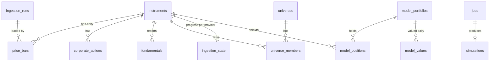

# Data model

The tables, their keys and indexes, why each index exists, and how big things get.

I write these as plain SQL migration files in `src/sim/sql/migrations/`. The sketches here
show the shape. The exact column list is mine to finish when I build each milestone.

## 1. Overview



| Group | Tables | Written by |
|---|---|---|
| Market data | `instruments`, `price_bars`, `corporate_actions`, `fundamentals` | worker (ingestion) |
| Universe | `universes`, `universe_members` | worker, CLI |
| Bookkeeping | `ingestion_runs`, `ingestion_state` | worker |
| Work | `jobs`, `schedules`, `simulations` | api (insert), worker (update) |
| Model portfolios | `model_portfolios`, `model_positions`, `model_values`, `snapshots` | worker |
| Admin | `admin_credentials`, `admin_sessions`, `settings` | api, CLI |

## 2. Market data

### instruments

One row per stock or ETF.

```sql
create table instruments (
  instrument_id int generated always as identity primary key,
  ticker        text not null unique,          -- 'MSFT'
  name          text not null,
  kind          text not null check (kind in ('stock', 'etf')),
  cik           int,                           -- SEC company id, null for most ETFs
  sic           text,                          -- SEC industry code, '7372'
  sector        text not null,                 -- my own grouping of SIC codes
  delisted_on   date                           -- null = still trading
);
```

- **Why a number as key and not the ticker?** `price_bars` repeats the key 25 million
  times. An `int` is 4 bytes. A ticker as text is 5 to 8 bytes plus overhead, and tickers
  change (Facebook: FB to META). The number never changes.
- Rows: about 530 in v1, about 5,000 at full size. Tiny.

### price_bars

The big one. One row per instrument per trading day. Raw prices, never changed after insert.

```sql
create table price_bars (
  instrument_id int  not null references instruments,
  day           date not null,
  open          real,
  high          real,
  low           real,
  close         double precision not null,
  volume        bigint,
  run_id        int  not null references ingestion_runs,
  primary key (instrument_id, day)
);
```

**Size.** A row is about 64 bytes on disk (24 bytes of row header that every Postgres row
has, plus the columns, plus padding).

| | v1 | Full size |
|---|---|---|
| Instruments | about 530 | about 5,000 |
| Rows (252 trading days × 20 years each) | about 2.7 million | about 25 million |
| Table | about 170 MB | about 1.6 GB |
| Primary key index | about 60 MB | about 550 MB |
| Together | about 230 MB | **about 2.2 GB** |

At full size, table plus index no longer fit into 2 GB of RAM. That is the designed problem.
From there on, which rows a query touches decides whether it takes 5 ms or 5 seconds.

**The one index, and why its order matters.** The primary key `(instrument_id, day)` is also
an index sorted by instrument first, then by day. The most common query is:

```sql
select day, close from price_bars
where instrument_id = any(:ids) and day between :from and :to
order by instrument_id, day;
```

With this order, all rows of one instrument sit next to each other in the index, already
sorted by day. The database jumps to "MSFT, 2016-11-14" and reads forward. With the order
reversed, `(day, instrument_id)`, the same query would have to visit every day of ten years
and pick 30 instruments out of 5,000 each time.

Things I deliberately do **not** add at the start, and when I will try them:

| Idea | What it does | When |
|---|---|---|
| Covering index `(instrument_id, day) include (close)` | The query is answered from the index alone, without touching the table (index-only scan). | Bottleneck loop, if price reads dominate. |
| Index on `(day)` or a BRIN index on `day` | Helps "all instruments on one day" (the daily valuation). BRIN is tiny but only works if rows are physically ordered by day. | When the daily model update gets slow. |
| `CLUSTER` on the primary key | Physically sorts the table like the index, so one instrument's rows share pages. | Bottleneck loop, measure before and after. |
| Partitioning by year | See section 6. | Its own bottleneck loop. |

Rule for myself: no index without a measured query that needs it. Every index makes inserts
slower and uses RAM that is scarce here.

### corporate_actions

Splits and dividends. Small, but essential for correct returns.

```sql
create table corporate_actions (
  instrument_id int  not null references instruments,
  ex_date       date not null,            -- first day the price reflects it
  kind          text not null check (kind in ('split', 'dividend')),
  value         double precision not null, -- split: 4.0 for 4-for-1, dividend: cash per share
  primary key (instrument_id, ex_date, kind)
);
```

Rows: a few per instrument per year. About 40,000 in v1, about 400,000 at full size.

How a daily total return is computed from raw data, for day $t$ with split factor $s_t$
(1 on normal days) and dividend $d_t$ (0 on normal days):

$$r_t = \frac{P_t \cdot s_t + d_t}{P_{t-1}} - 1$$

### fundamentals

Company numbers from SEC EDGAR, each with the day it became public.

```sql
create table fundamentals (
  instrument_id int  not null references instruments,
  concept       text not null,   -- 'NetIncomeLoss', 'Liabilities', 'StockholdersEquity'
  period_end    date not null,   -- the quarter or year the number describes
  filed_at      date not null,   -- the day the SEC published it
  value         double precision not null,
  form          text not null,   -- '10-K', '10-Q', '10-K/A'
  primary key (instrument_id, concept, period_end, filed_at)
);
create index fundamentals_as_of on fundamentals (instrument_id, concept, filed_at desc);
```

- `filed_at` is part of the key because companies correct old numbers later. Both versions
  are kept. A backtest in 2019 must see the 2019 version.
- The "as of" query, which is the heart of avoiding look-ahead bias:

```sql
select distinct on (instrument_id) instrument_id, value
from fundamentals
where concept = 'NetIncomeLoss' and filed_at <= :as_of
order by instrument_id, filed_at desc, period_end desc;
```

- The second index exists for exactly this query: per instrument and concept, newest filing
  first.
- Rows: 530 companies × about 8 concepts × about 70 quarters, roughly 300,000 in v1 and
  3 million at full size.

## 3. Universe

```sql
create table universes (
  universe_id int generated always as identity primary key,
  slug text not null unique,   -- 'us-large', 'core-etfs', 'theme-ai', 'industry-healthcare'
  name text not null
);
create table universe_members (
  universe_id   int  not null references universes,
  instrument_id int  not null references instruments,
  from_date     date not null,
  to_date       date,           -- null = still a member
  primary key (universe_id, instrument_id, from_date)
);
```

`from_date` and `to_date` make membership a question with a date: "who was in this list on
1 March 2019?" In v1 every member simply starts on the first data day, which is exactly the
survivorship bias I admit to. The table is already shaped for the honest version.

## 4. Bookkeeping for ingestion

```sql
create table ingestion_runs (
  run_id      int generated always as identity primary key,
  provider    text not null,
  kind        text not null,            -- 'prices', 'fundamentals'
  started_at  timestamptz not null default now(),
  finished_at timestamptz,
  rows_added  int not null default 0
);
create table ingestion_state (
  provider      text not null,
  instrument_id int  not null references instruments,
  last_day      date,                   -- newest day already stored
  failures      int  not null default 0,
  primary key (provider, instrument_id)
);
```

- **`data_version`** in the API is the highest `run_id` that added at least one row. A
  simulation stores it. Same inputs and same `data_version` must give the same result.
- **`ingestion_state`** is what makes a download resumable. The job asks "which instruments
  are behind?", fetches a few, updates the row, repeats. If it is stopped by the hourly rate
  limit or a crash, the next run continues where it stopped.

## 5. Work: jobs, schedules, simulations

```sql
create table jobs (
  job_id          uuid primary key,
  kind            text not null,
  status          text not null default 'queued'
                  check (status in ('queued','running','succeeded','failed','cancelled')),
  args            jsonb not null default '{}',
  attempts        int not null default 0,
  max_attempts    int not null default 3,
  run_after       timestamptz not null default now(),  -- retries wait until then
  locked_by       text,
  heartbeat_at    timestamptz,
  progress        real not null default 0,
  message         text,
  error           jsonb,
  idempotency_key text unique,
  created_at      timestamptz not null default now(),
  started_at      timestamptz,
  finished_at     timestamptz
);
create index jobs_queue on jobs (run_after) where status = 'queued';
```

- **The partial index** (`where status = 'queued'`) only contains waiting jobs. The table
  may hold 100,000 finished jobs; the index the worker searches holds maybe three.
- **Claiming a job**, the query everything else is built around:

```sql
update jobs set status = 'running', locked_by = :worker, started_at = now(),
                heartbeat_at = now(), attempts = attempts + 1
where job_id = (
  select job_id from jobs
  where status = 'queued' and run_after <= now()
  order by run_after
  for update skip locked
  limit 1
)
returning *;
```

```sql
create table simulations (
  simulation_id uuid primary key references jobs (job_id),
  params        jsonb not null,      -- with all defaults filled in
  request_hash  text  not null,      -- sha256 of the sorted params
  data_version  int   not null,
  result        jsonb,
  unique (request_hash, data_version)
);
```

- **The unique pair is the result cache.** Same question on the same data: the insert hits
  the unique rule, and the API returns the row that is already there. When new prices
  arrive, `data_version` changes and the same question is computed fresh. No separate
  invalidation logic.
- `schedules` is a small table: name, job kind, args, time of day, `next_run_at`.
- Old rows: a daily clean-up deletes finished jobs after 30 days. Simulations go with them.

## 6. Model portfolios

```sql
create table model_portfolios (
  portfolio_id int generated always as identity primary key,
  risk_level   text not null unique check (risk_level in ('low','medium','high')),
  started_on   date not null,
  start_value  double precision not null,
  params       jsonb not null,       -- the exact inputs used to build it
  data_version int not null
);
create table model_positions (
  portfolio_id  int not null references model_portfolios,
  instrument_id int not null references instruments,
  shares        double precision not null,
  from_date     date not null,
  to_date       date,
  primary key (portfolio_id, instrument_id, from_date)
);
create table model_values (
  portfolio_id    int  not null references model_portfolios,
  day             date not null,
  value           double precision not null,
  benchmark_value double precision not null,
  primary key (portfolio_id, day)
);
```

- Positions are stored as **shares**, not weights. Value on a day = sum of shares × close.
  Weights drift as prices move, shares do not.
- `model_values` grows by 3 rows a day. About 750 rows a year.
- `snapshots (as_of date primary key, payload jsonb, built_at)` holds the daily summary
  that the dashboard and `GET /v1/snapshot/latest` serve. One primary-key read for the most
  visited page. Old rows stay, so I can see what the dashboard showed on any day.

## 6a. Admin

```sql
create table admin_credentials (
  id            boolean primary key default true check (id),  -- at most one row
  password_hash text not null,                                -- Argon2id, never the password
  changed_at    timestamptz not null default now()
);
create table admin_sessions (
  session_hash text primary key,          -- sha256 of the random id in the cookie
  csrf_token   text not null,
  created_at   timestamptz not null default now(),
  expires_at   timestamptz not null
);
create table settings (
  key   text primary key,
  value jsonb not null,
  updated_at timestamptz not null default now()
);
```

- **Why the session id is stored as a hash:** if someone ever reads this table (a backup, a
  bug), they still cannot log in with what they find. The cookie holds the real id.
- **Why sessions are in the database at all** and not just a signed cookie: so logout and
  "password changed" really end a session. A signed cookie stays valid until it expires.
- `settings` holds the few values from the admin settings page. The API reads them with a
  short in-memory cache (10 seconds), so a busy site does not query them on every request.
- No table stores IP addresses. Rate limit counters live in the API's memory.

## 7. Partitioning plan

Partitioning splits `price_bars` into one table per year that still acts like one table.

```sql
create table price_bars (...) partition by range (day);
create table price_bars_2025 partition of price_bars
  for values from ('2025-01-01') to ('2026-01-01');
```

I do **not** start with it. I start with one plain table, load the full 25 million rows in
M6, measure, and then partition as its own bottleneck loop. Reasons:

- I want the before number. Without it there is no story.
- It is not obviously a win. What I expect, to be checked:

| Query | Expected effect of yearly partitions |
|---|---|
| Daily update: "all instruments, last 5 days" | Faster. Only the newest partition is touched, and it stays in memory. |
| Inserts of new days | Faster and steadier. The index being written is the small one for this year. |
| Backtest: "30 instruments, 10 years" | About the same or slightly slower. It must open 10 partitions. The `(instrument_id, day)` index was already doing the work. |
| Deleting or archiving old years | Much easier: drop a partition instead of deleting millions of rows. |

- The partition key must be part of the primary key. `(instrument_id, day)` already
  contains `day`, so nothing changes there.
- Moving the data: create the partitioned table next to the old one, copy year by year,
  swap names in one transaction. Practised first on a copy.

## 8. Postgres settings for 2 GB

Set in the compose file, written down here so I can explain each one.

| Setting | Value | Why |
|---|---|---|
| `shared_buffers` | 512MB | Postgres' own page cache. A quarter of RAM is the usual start. |
| `effective_cache_size` | 1500MB | A hint to the planner about how much the OS also caches. |
| `work_mem` | 16MB | Memory per sort or hash step, per query. Too high × many queries = out of memory. |
| `maintenance_work_mem` | 128MB | For building indexes. |
| `max_connections` | 20 | Each connection costs memory. API and worker share a small pool. |
| `shared_preload_libraries` | pg_stat_statements | Tracks which queries take the most time. |
| `log_min_duration_statement` | 200ms | Logs every slow query. |

## 9. Database roles

| Role | May do |
|---|---|
| `sim_owner` | Owns the tables. Used only by migrations. |
| `sim_api` | Read everything. Insert into `jobs` and `simulations`. Update `jobs.status` to `cancelled`. Read and write `admin_sessions` and `settings`. Read `admin_credentials`. |
| `sim_worker` | Read and write everything except changing the table structure. |

The API cannot change a price, even if someone found a bug in it.
