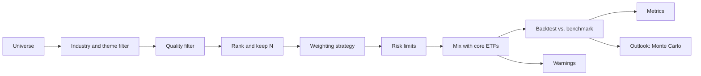

# Analysis

Every number the simulator produces: what it means, the formula, what it assumes, where it
breaks, and a tiny example I can turn into a test.

The methods are deliberately common and simple. This is not a quant project. I should be
able to explain each one at a whiteboard.

Notation used throughout:

- $P_t$: price of one instrument at the end of day $t$
- $V_t$: value of the whole portfolio at the end of day $t$
- $r_t$: return of day $t$
- $w_i$: weight of instrument $i$ (share of the money), with $\sum_i w_i = 1$
- $T$: number of trading days in the period, and 252 trading days in a year

## 1. The pipeline in one picture

## 2. Returns

### Simple and log returns

**Intuition.** A return is "how much did it grow today, as a fraction".

$$r_t = \frac{P_t}{P_{t-1}} - 1 \qquad\qquad \ell_t = \ln\frac{P_t}{P_{t-1}} = \ln(1 + r_t)$$

Simple returns $r_t$ combine across **instruments**: the portfolio's return on a day is the
weighted sum $\sum_i w_i r_{i,t}$. Log returns $\ell_t$ combine across **time**: the log
return over several days is the plain sum of the daily ones. I use each where it adds up.

**With splits and dividends** (the total return, see `03-data-model.md`), with split factor
$s_t$ and dividend $d_t$:

$$r_t = \frac{P_t \cdot s_t + d_t}{P_{t-1}} - 1$$

**Assumes:** dividends are reinvested on the day they are paid, with no tax.
**Breaks:** a missing day. If Tuesday is missing, Wednesday's "daily" return covers two days.
I must detect gaps and never silently fill them.

**Test examples.**

- Prices 100, 110, 99: simple returns $0.10$ and $-0.10$. Log returns sum to
  $\ln(99/100) = -0.01005$.
- Price 400 on Monday, 4-for-1 split, price 101 on Tuesday: return is
  $(101 \cdot 4)/400 - 1 = 0.01$, not $-0.7475$.
- Price 50, next day 49.50 with a dividend of 1.00: return is $(49.5 + 1)/50 - 1 = 0.01$.

### Annualised return and CAGR

**Intuition.** "If it had grown by the same percentage every year, what would that be?"

$$\text{CAGR} = \left(\frac{V_T}{V_0}\right)^{252/T} - 1$$

**Test:** 10,000 to 12,100 over exactly 504 trading days (two years) gives $0.10$.

## 3. Risk

### Volatility

**Intuition.** How widely daily returns scatter around their average. In Stochastik terms:
the standard deviation of the random variable "daily return", estimated from a sample.

$$\hat\sigma_{\text{daily}} = \sqrt{\frac{1}{T-1}\sum_{t=1}^{T}\left(\ell_t - \bar\ell\right)^2} \qquad\qquad \hat\sigma_{\text{year}} = \hat\sigma_{\text{daily}} \cdot \sqrt{252}$$

Why $\sqrt{252}$: for independent days, variances add up, so the variance of a year is
$252\,\sigma^2_{\text{daily}}$, and the standard deviation is the square root of that.

**Assumes:** daily returns are independent and equally distributed.
**Breaks:** they are not. Calm and stormy days cluster (volatility in March 2020 was
several times the normal level). One number hides that.

**Test:** returns alternating $+0.01, -0.01$ for 252 days have mean 0 and daily standard
deviation very close to $0.01$, so yearly volatility is about $0.159$.

### Covariance and correlation matrix

**Intuition.** Do two stocks tend to move together? This is what makes diversification work:
two risky things that do not move together are less risky as a pair.

$$\hat\Sigma_{ij} = \frac{1}{T-1}\sum_{t}(r_{i,t}-\bar r_i)(r_{j,t}-\bar r_j) \qquad \rho_{ij} = \frac{\hat\Sigma_{ij}}{\hat\sigma_i\,\hat\sigma_j}$$

Portfolio variance, straight from the rule $\operatorname{Var}(aX+bY) = a^2\operatorname{Var}(X) + b^2\operatorname{Var}(Y) + 2ab\operatorname{Cov}(X,Y)$:

$$\sigma_p^2 = w^\top \Sigma\, w$$

**Breaks:** correlations are not stable. In a crash almost everything falls together, so
correlations rise exactly when diversification is needed. Also, with $N$ stocks there are
$N(N-1)/2$ correlations to estimate; with few days of data the matrix is noisy.

**Test:** two stocks, each with $\sigma = 0.2$, weights $0.5$ each. Correlation $1$ gives
$\sigma_p = 0.2$. Correlation $0$ gives $\sigma_p = \sqrt{0.02} \approx 0.1414$. Correlation
$-1$ gives $0$.

### Maximum drawdown

**Intuition.** The worst "from the top to the bottom" loss someone holding the portfolio
would have lived through.

$$\text{MDD} = \min_t \left(\frac{V_t}{\max_{s \le t} V_s} - 1\right)$$

**Assumes nothing** about distributions, which is why I like it.
**Breaks:** it describes one path that happened. A longer history can only make it worse.

**Test:** values 100, 120, 90, 130, 117 give $90/120 - 1 = -0.25$ (not $117/130 - 1 = -0.10$).

### Value at Risk and Expected Shortfall

**Intuition.** VaR answers "how bad is a bad day?": on 95 of 100 days the loss is smaller
than this. It is simply the 5% quantile of the daily returns. Expected Shortfall answers
the follow-up: "and on the other 5 days, how bad on average?"

With $q_\alpha$ the empirical $\alpha$-quantile of the daily returns and $\alpha = 0.05$:

$$\text{VaR}_{95} = q_{0.05}(r) \qquad\qquad \text{ES}_{95} = \operatorname{E}\left[\,r \mid r \le q_{0.05}(r)\,\right]$$

I use the **historical** method: sort the real past returns and read off the quantile. No
normal distribution is assumed.

**Assumes:** the future looks like the sample.
**Breaks:** fat tails. Real markets have far more extreme days than a normal curve allows,
and the worst day in my sample is probably not the worst day possible. VaR also says
nothing about how bad the tail is, which is why I always show ES next to it.

**Test:** 100 returns: $-0.10, -0.09, \dots$ arranged so the five smallest are
$-0.10, -0.08, -0.06, -0.05, -0.04$. ES is their mean, $-0.066$. VaR depends on the quantile
method, so I fix one (numpy's default linear interpolation) and write it down in the test.

## 4. Performance

### Sharpe ratio

**Intuition.** Return per unit of risk. Two portfolios with the same return are not equally
good if one was a much wilder ride.

$$\text{Sharpe} = \frac{\bar r_{\text{year}} - r_f}{\hat\sigma_{\text{year}}}$$

$r_f$ is the risk-free rate (what a safe government bill pays). In v1 I set $r_f = 0$ and
say so on the page. Later it can come from a data plugin.

**Breaks:** it treats upside and downside swings as equally bad, and it is noisy over short
periods. A Sharpe ratio from 8 months of data means little. That is why the snapshot
sends `null` until there are 60 trading days.

**Test:** yearly return $0.10$, volatility $0.20$, $r_f = 0$: Sharpe $= 0.5$.

### Comparison with the benchmark

The benchmark is buy-and-hold of SPY with the same starting money on the same days. I show
both value lines, both sets of metrics, and the yearly returns next to each other. No
fancier statistic in v1. The honest sentence on the page is simply "the portfolio returned
X, SPY returned Y".

## 5. Picking stocks

Simple rules, fixed before looking at results. All of them use only data known on the
decision day (the "as of" queries from `03-data-model.md`).

1. **Universe.** The large US stocks I track, plus a short list of core ETFs.
2. **Industry and theme filter.** If the user chose industries or themes, keep only those
   stocks. Industries come from SIC codes mapped to about ten sectors. Themes come from
   small hand-made lists.
3. **Quality filter.** Drop a company if any of these is true, using the latest filings
   known on that day:
   - net income over the last four quarters is negative (no negative earnings),
   - total liabilities divided by shareholders' equity is above 3, or equity is negative
     (no extreme debt). Financial companies are exempt from this one, because banks
     naturally run on borrowed money.
   - fewer than three years of price history (not enough data to estimate risk).
4. **Rank and keep $N$.** Rank the survivors by lowest volatility over the last three years
   for low risk, and by 12-month return for medium and high risk. Keep $N$ names:
   8 for low, 12 for medium, 15 for high. If fewer than 5 survive, the simulation fails
   with `universe_too_small`.

**Why these rules:** each fits in one sentence and has an obvious reason. They are a fair
baseline, not a discovery.
**Where they break:** "low debt, positive earnings" would have excluded Amazon for years.
Ranking by past return (momentum) works until it sharply does not.

**Tests:** build a fake universe of six companies by hand, where two have negative
earnings and one has too much debt. Exactly three must survive. Move one filing date to
after the decision day and check that the old value is used.

## 6. Weighting strategies

Each strategy is a plugin (see `06-plugins.md`). Input: the returns of the picked stocks up
to the decision day. Output: weights that sum to 1.

### Equal weight (1/N): the baseline

$$w_i = \frac{1}{N}$$

**Intuition.** Admit that I cannot tell which stock is better and split evenly.
**Assumes:** nothing. That is its strength: no estimate can be wrong.
**Breaks:** a very wild stock gets the same money as a calm one.
**Test:** 4 stocks, each weight is $0.25$.

### Inverse volatility

$$w_i = \frac{1/\hat\sigma_i}{\sum_j 1/\hat\sigma_j}$$

**Intuition.** Give calmer stocks more money, so each position contributes a similar
amount of wobble.
**Assumes:** past volatility predicts future volatility (reasonably true), and it ignores
correlations completely.
**Breaks:** two calm stocks that move together get a lot of weight and act like one big
position.
**Test:** volatilities $0.10$ and $0.30$: inverse values $10$ and $3.33$, weights $0.75$
and $0.25$.

### Minimum variance

**Intuition.** Among all ways to split the money, find the one with the smallest total
wobble, using the correlations too.

$$\min_{w}\; w^\top \Sigma\, w \qquad \text{subject to} \qquad \sum_i w_i = 1,\quad 0 \le w_i \le w_{\max}$$

One call to `scipy.optimize.minimize` with the SLSQP method. No short selling ($w_i \ge 0$)
and a cap per stock.

**Assumes:** the covariance matrix estimated from the past holds in the future.
**Breaks:** this is the method most sensitive to estimation noise. Without the cap it
happily puts 60% into the one stock that happened to be calm. The cap $w_{\max}$ is not
optional.
**Test:** two uncorrelated stocks with variances $0.04$ and $0.01$, no cap. The known
answer is $w_1 = \frac{\sigma_2^2}{\sigma_1^2 + \sigma_2^2} = 0.2$ and $w_2 = 0.8$. My
optimiser must land within $0.001$ of that.

## 7. Risk levels and limits

A risk level is a small table of numbers, not a feeling. Starting values, mine to adjust
once, before the model portfolios start:

| | Low | Medium | High |
|---|---|---|---|
| Target volatility per year | 8% | 14% | 22% |
| Share in core ETFs | 80% | 50% | 20% |
| Max weight per single stock | 5% | 10% | 12% |
| Max weight per sector (stocks only) | 30% | 35% | 45% |
| Names picked | 8 | 12 | 15 |
| Default weighting | inverse volatility | inverse volatility | equal weight |

The single-stock cap applies to picked stocks, not to the broad core ETFs, and it is a
share of the whole portfolio. It is the `max_weight_per_instrument` that
`GET /v1/meta/options` reports.

**Core + satellite.** The core is a fixed mix of broad ETFs (stocks and bonds, more bonds
for low risk). The satellites are the picked stocks. Final weights:

$$w^{\text{final}} = c \cdot w^{\text{core}} + (1 - c) \cdot w^{\text{satellite}}$$

with $c$ the core share from the table.

**Applying caps.** After weighting, clip any weight above its cap and spread the excess
over the others in proportion to their weights. Repeat until nothing is above a cap.

**Test:** weights $0.5, 0.3, 0.2$ with a cap of $0.4$ become $0.4, 0.36, 0.24$.

**Volatility target.** After the mix, estimate $\sigma_p = \sqrt{w^\top \Sigma w}$. If it is
more than a fifth away from the target, add a `volatility_off_target` warning. I do not
force it to the target in v1. Reporting honestly is simpler and teaches more than hiding it
behind leverage.

### Warnings

| Code | Rule |
|---|---|
| `instrument_concentration` | One position is above 20% of the portfolio. |
| `sector_concentration` | One sector's stocks are more than 25% of the portfolio (`info`), or more than 30% (`warning`). |
| `etf_overlap` | A picked stock is also among the top 10 holdings of a core ETF. Its real weight is its own weight plus ETF weight × its share in the ETF. |
| `short_history` | A position has less than five years of prices. |
| `survivorship_bias` | Always, while the universe only has today's companies. |
| `volatility_off_target` | See above. |

ETF top holdings come from a small hand-made file per core ETF, refreshed by hand a few
times a year. It only feeds the warning, not the maths.

## 8. The backtester

**Intuition.** Replay history one day at a time, and at each step allow the strategy to see
only what was known that day.

The loop:

1. On the first day, pick and weight using data **up to the day before**. Buy with the
   closing prices of the first day: shares $= $ money for that position $/$ price.
2. Each following day: apply splits to share counts, add dividends as cash and reinvest
   them in the same stock, then $V_t = \sum_i \text{shares}_{i} \cdot P_{i,t}$.
3. On a rebalance day (yearly by default): compute target weights again from data up to the
   day before, and trade to them at that day's close.
4. The benchmark runs through the same loop with one instrument.

**The rule that prevents look-ahead:** the function that makes decisions receives a data
object that is cut off at the decision date. It cannot ask for later data, because the
object does not have it. A test tries to and must get an error.

**Assumes:** I can trade any amount at the closing price, fractional shares exist, and
trading is free. v1 ignores costs and taxes and says so on the page.
**Breaks:** for small or illiquid stocks the closing price is not really available to buy.

**Tests.**

- One stock, no rebalancing: portfolio value must equal money × price ratio on every day.
- Two stocks, 50/50, prices: A doubles, B stays flat, then both stay flat. Without
  rebalancing the final weights are 2/3 and 1/3. With a rebalance after the move they are
  back to 50/50, and the total value is unchanged by the rebalance itself.
- "Poisoned future" test: copy the price table, replace every price after day $d$ with
  nonsense. Decisions made on day $d$ must be identical to those on the clean data.

## 9. The outlook: Monte Carlo by bootstrap

**Intuition.** I do not know the future, but I have a few thousand real daily returns of
this portfolio. I build a possible future by drawing days from that history at random, with
replacement, and chaining them. Doing that 1,000 times gives 1,000 possible futures. Then I
show where most of them end, as percentiles. It is a range, not a forecast.

**Link to Stochastik.** Each simulated final value is one draw of a random variable. By the
law of large numbers, the share of paths below some value converges to the true probability
under my model as the number of paths grows. The percentiles I show are empirical quantiles
of those draws.

**Block bootstrap.** Drawing single days destroys the fact that stormy days come in groups.
So I draw blocks of 20 consecutive days instead. With a horizon of $H$ trading days and
blocks of length $b = 20$:

1. Draw $\lceil H/b \rceil$ random start positions in the history.
2. Glue the blocks of daily returns together and cut to length $H$.
3. Path value: $V_h = V_0 \prod_{t=1}^{h} (1 + r_t)$.
4. Repeat for 1,000 paths. At each month, take the 5th, 25th, 50th, 75th and 95th
   percentile across paths.

**Reproducibility.** All randomness comes from one generator created as
`numpy.random.default_rng(seed)`. The seed is stored with the result. Same seed, same data,
same paths, to the last digit.

**How precise are the percentiles?** With $n = 1000$ paths, the estimated share of paths
below a level has standard error $\sqrt{p(1-p)/n}$. For $p = 0.05$ that is about $0.007$. So
the 5% line is really "somewhere between the 3.6% and 6.4% line". Good enough for a band on
a chart, and a nice confidence interval question for an interview.

**The honest note that goes on every results page.** This method can only reshuffle what
already happened. It cannot produce a crash worse than the worst block in the sample, it
assumes the next ten years are drawn from the same world as the last ones, and it keeps the
weights fixed. The band is too narrow rather than too wide.

**Tests.**

- Same seed twice: identical output. Different seed: different output.
- History where every daily return is exactly $0.001$: every path is identical, and all
  percentiles equal $V_0 \cdot 1.001^{h}$.
- With many paths, the median of the final values is close to
  $V_0 \cdot \exp(H \cdot \bar\ell)$, where $\bar\ell$ is the mean daily log return.

## 10. Strategy experiments for later

Not in v1. Each is one new plugin plus one comparison chart.

- **Rebalancing vs. buy-and-hold:** the backtester already supports both; compare them.
- **Timing rules:** "sell after an $X\%$ rise, buy back after a $Y\%$ drop". The honest
  expectation is that it loses to buy-and-hold on most periods, and showing that with my
  own data is the interesting result. Danger: trying many $X, Y$ pairs and keeping the best
  is overfitting by definition. I must report all of them.

## 11. How I test numerical code in general

- Every function in `core/` gets a test with numbers small enough to check by hand.
- Compare floats with a tolerance: `pytest.approx(expected, rel=1e-9)`.
- Property checks where they exist: weights sum to 1, no weight is negative, max drawdown
  is never positive, the 5% line is never above the 95% line.
- One "golden" test: a fixed small data set in the repo, a fixed seed, and the full result
  stored as a file. If any number changes, the test fails and I must decide whether that was
  intended.
